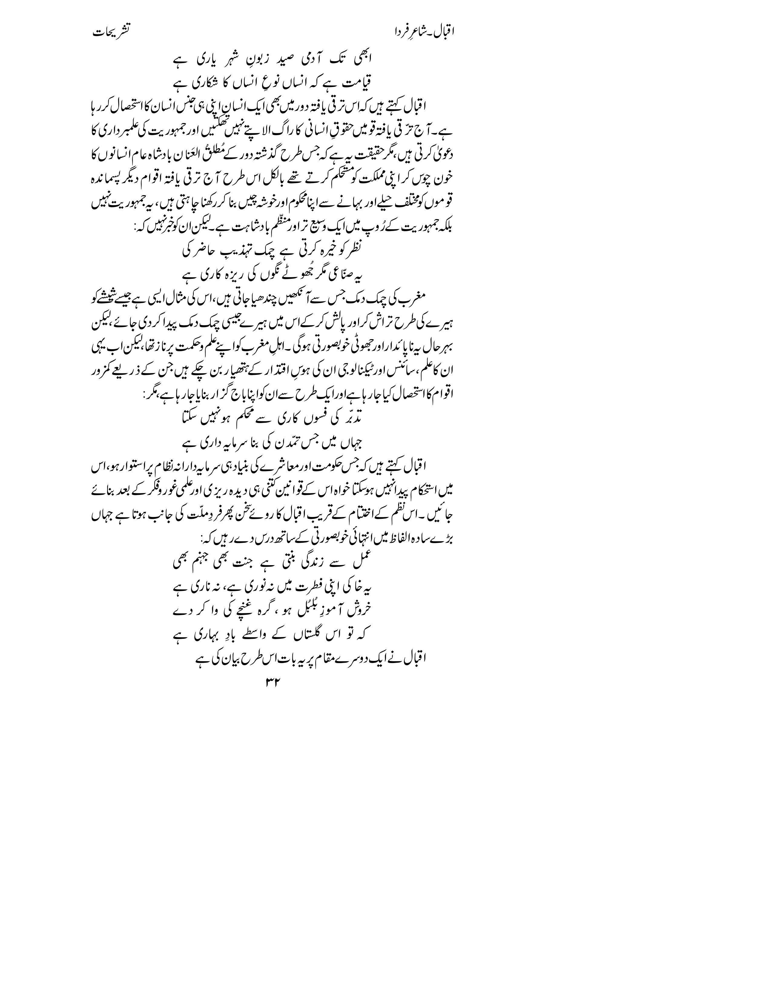

# Urdu-Orator-OCR-Dataset

### A Multi-Category Urdu Document Dataset for Optical Character Recognition (OCR)

**Urdu-Orator-OCR-Dataset** is a dataset repository associated with **Orator-OCR**, a unified Urdu Optical Character Recognition (OCR) research project. It focuses on Urdu documents collected from different sources and writing conditions to support OCR research, text recognition, document digitization, and dataset annotation.

The repository covers four major categories of Urdu documents:

- Printed / PDF documents
- Handwritten documents
- Camera-captured documents
- Historical documents

It provides organized document images, OCR-generated text, manually aligned text, and corrected annotations where available.

---

## Table of Contents

- [Project Overview](#project-overview)
- [Dataset Categories](#dataset-categories)
- [Dataset Sample Preview](#dataset-sample-preview)
- [Dataset Organization](#dataset-organization)
- [Data Collection and Annotation Workflow](#data-collection-and-annotation-workflow)
- [Image Preprocessing](#image-preprocessing)
- [OCR Evaluation](#ocr-evaluation)
- [My Contribution](#my-contribution)
- [Repository Structure](#repository-structure)
- [Repository Status](#repository-status)
- [Data Availability and Usage](#data-availability-and-usage)
- [Project Information](#project-information)

---

## Project Overview

Urdu OCR presents several challenges because of the cursive nature of the script, connected ligatures, overlapping strokes, diacritical marks, and variations in document quality.

The Orator-OCR project explored a unified approach to processing different types of Urdu documents through document-specific preprocessing, line segmentation, and OCR recognition.

The research focused on developing an OCR workflow capable of handling printed, handwritten, camera-captured, and historical Urdu documents.

This repository documents the dataset categories, collection process, annotation workflow, and supporting research information associated with the project.

---

## Dataset Categories

### 1. Printed / PDF Dataset

**Directory:** `datasets/printed_pdf/`

A collection of digitized printed Urdu book pages and PDF-based documents.

According to the project thesis, the collection includes:

- **3,603** collected pages
- **16** books
- **13** writers
- **5** publishers
- Publication period: 1993–2018

The dataset includes printed Urdu documents with variations in typography, page layouts, and publishing formats.

The preparation workflow includes image collection, OCR extraction, text alignment, and correction.

### 2. Handwritten Dataset

**Directory:** `datasets/handwritten/`

A collection of handwritten Urdu documents contributed by different writers.

According to the project thesis, the dataset contains:

- **954** collected pages
- **477** writers
- **74** institutions
- Contributor age range: 14–54 years

The handwritten data preparation workflow included:

1. Collecting handwritten Urdu document images.
2. Obtaining initial text through Google OCR.
3. Manually aligning extracted text line by line with the corresponding image.
4. Reviewing and correcting OCR-generated errors.
5. Preparing corrected text annotations.

The handwritten dataset includes the following processing stages:

- Original images
- Google OCR text
- Aligned text
- Aligned and annotated text

### 3. Camera-Captured Dataset

**Directory:** `datasets/Camera-Captured/`

A collection of Urdu document pages photographed using different camera devices and viewing angles.

According to the project thesis, the collection includes:

- **1,415** pages
- **283** books
- **253** writers
- **144** publishers

The dataset represents real-world document capture conditions, including variations in illumination, focus, perspective, orientation, and camera quality.

### 4. Historical Dataset

**Directory:** `datasets/historical/`

A collection of historical Urdu document pages representing different levels of document aging and degradation.

According to the project thesis, the collection includes:

- **1,505** pages
- **22** historical books

The dataset represents different paper conditions and discoloration patterns, including:

- Yellow pages
- Gray pages
- Yellow-gray pages
- Brown-discolored pages

These variations provide challenging examples for historical Urdu document recognition.

---

## Dataset Sample Preview

### Printed Urdu Document Sample

The following example demonstrates an original printed Urdu document image from the dataset and its associated OCR text annotations.



**Image file:** `3382_Page32.jpg`

**Associated annotation files:**

- [Google OCR Output](datasets/printed_pdf/google_ocr/3382_Page_32_googleoutput.txt)
- [Corrected Text Annotation](datasets/printed_pdf/corrected_text/3382_Page_32.txt)

This example illustrates the relationship between the original document image, machine-generated OCR output, and manually reviewed text annotations.

---

## Dataset Organization

The repository is organized into four separate dataset directories.

Each category contains its own README file describing its collection, characteristics, and preparation workflow.

The dataset processing stages include the following, where available:

| Processing Stage | Description |
|---|---|
| Original Images | Source Urdu document images |
| Google OCR Output | Initial machine-generated text |
| Aligned Text | Text manually aligned with the corresponding document content |
| Corrected Text | Manually reviewed and corrected annotations |

This organization makes it possible to examine different stages of OCR text preparation and compare machine-generated output with manually reviewed annotations.

---

## Data Collection and Annotation Workflow

The project involved collecting Urdu document images and preparing corresponding text annotations for OCR research.

The general preparation workflow includes:

1. **Image Collection:** Gathering Urdu document images from different document categories.
2. **OCR Extraction:** Obtaining initial text using Google OCR.
3. **Text Alignment:** Matching extracted text with the corresponding document content.
4. **Manual Review:** Reviewing OCR-generated text and identifying recognition errors.
5. **Text Correction:** Correcting inaccurate text to prepare improved reference annotations.

For the handwritten dataset, text alignment was performed manually, line by line, with corresponding document images. The extracted text was also manually reviewed and corrected.

These stages provide useful resources for studying OCR output quality and the relationship between machine-generated and manually corrected text.

---

## Image Preprocessing

The Orator-OCR research explored document-specific preprocessing techniques for different Urdu document categories.

| Dataset Category | Preprocessing Techniques |
|---|---|
| Printed / PDF | Grayscale conversion and Sauvola binarization |
| Historical | Denoising, background estimation, illumination normalization, stroke enhancement, and Wolf–Jolion binarization |
| Camera-Captured | Perspective transformation, document dewarping, and skew correction |
| Handwritten | Page preprocessing and histogram-based line segmentation |

These techniques were explored to improve document appearance and prepare images for subsequent OCR processing.

---

## OCR Evaluation

The project thesis describes OCR evaluation using:

- **Character Error Rate (CER)**
- **Ligature Error Rate (LER)**

The OCR experiments compared several recognition approaches, including:

- Google OCR
- UTRNet (HRNet + BiLSTM + CTC)
- Qwen2-VL-2B-Instruct
- CNN + RoBERTa + GPT-2 architecture

The thesis reports that UTRNet did not converge on the handwritten dataset during the reported experiments.

Detailed evaluation results and experimental findings are documented in the Orator-OCR research thesis.

---

## My Contribution

My contribution to the Orator-OCR project included Urdu OCR dataset collection and preparation, particularly the handwritten dataset collection and annotation workflow.

My work involved:

- Collecting Urdu document images.
- Obtaining initial text through Google OCR.
- Manually aligning extracted text line by line with corresponding document images.
- Reviewing OCR-generated text.
- Correcting recognition errors and preparing annotated text files.
- Organizing dataset images and their corresponding text annotations.

This repository is organized to present the dataset work, annotation stages, and supporting documentation in a structured and accessible format.

---

## Repository Structure

The main repository is organized as follows:

```text
Urdu-Orator-OCR-Dataset/
│
├── README.md
│
└── datasets/
    │
    ├── README.md
    │
    ├── printed_pdf/
    │   ├── README.md
    │   ├── images/
    │   ├── google_ocr/
    │   ├── aligned_text/
    │   └── corrected_text/
    │
    ├── handwritten/
    │   ├── README.md
    │   ├── images/
    │   ├── google_text/
    │   ├── aligned_text/
    │   └── aligned_and_annotated_text/
    │
    ├── Camera-Captured/
    │   ├── README.md
    │   ├── images/
    │   ├── Google-OCR/
    │   ├── aligned_text/
    │   └── corrected_text/
    │
    └── historical/
        └── README.md
```

*Note: This structure illustrates the intended organization. Actual folders and capitalization should match the uploaded repository contents.*

---

## Repository Status

The repository contains documentation and uploaded dataset files for the four Urdu document categories:

- Printed / PDF
- Handwritten
- Camera-Captured
- Historical

Each category has its own documentation describing its dataset characteristics and preparation workflow.

The repository presents the collected data, OCR outputs, aligned text, and corrected annotations where available.

---

## Data Availability and Usage

Dataset availability depends on the permissions and sharing rights associated with the collected documents and their transcriptions.

Only material authorized for public distribution should be included in this repository.

Historical book scans, copyrighted printed material, and handwritten contributions require appropriate sharing permissions. Personal identifying information and contributor details should not be published without authorization.

Please contact the repository owner regarding dataset access, research collaboration, or permitted usage.

---

## Project Information

| Attribute | Details |
|---|---|
| Project | Orator-OCR |
| Repository | Urdu-Orator-OCR-Dataset |
| Research Area | Urdu Optical Character Recognition |
| Primary Language | Urdu |
| Dataset Categories | Printed / PDF, Handwritten, Camera-Captured, Historical |
| Data Types | Document Images and Text Annotations |
| Annotation Stages | Google OCR, Alignment, Correction |

---

*This repository documents the dataset collection, preparation, and annotation work associated with the Orator-OCR research project.*
